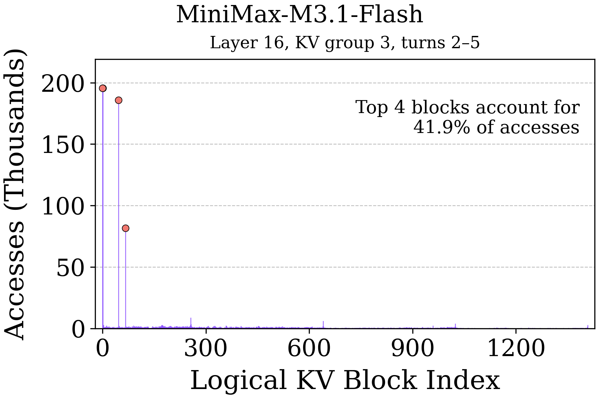
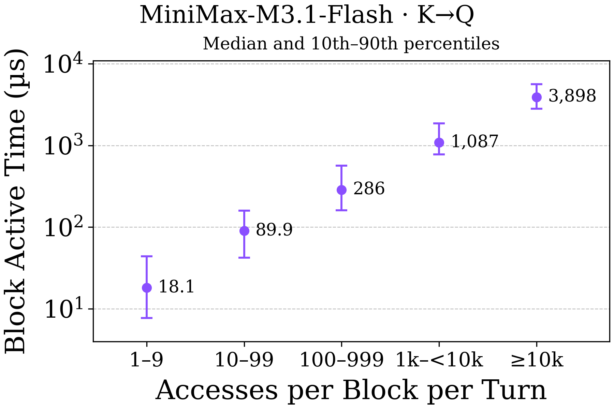

# 多轮增量 Prefill 中，优先处理 KV 热块有望以计算覆盖冷块传输

## 本周进展

本周以 MiniMax-M3.1-Flash 为研究对象，围绕多轮增量 Prefill 中历史 KV 的加载开销，分析原生稀疏注意力的访存瓶颈和 KV 块访问特征。当前观察到，一次追加输入需要读取的历史块并集仍可能很大，同时，不同块的访问次数和活跃计算时间有明显差异。

在多轮对话中，新一轮输入可以复用之前生成的历史 KV。增量 Prefill 计算新增 token 的 Query，再读取这些 Query 所需的历史 KV。若需要的块已卸载到 CPU 内存，GPU 必须等对应数据到位才能计算该块的注意力。因此，除了关注一轮需要搬运多少数据，还需要考虑哪些块应优先到位。

单个 Query 只选取部分历史 KV 块，但一次追加输入包含多个 Query，各 Query 选择的块可能不同。CPU 到 GPU 的取页需求取决于这些选择结果去重后的并集。例如，两个 Query 分别访问 {A, B} 和 {A, C}，总共有 4 次块访问，去重后涉及 A、B、C 三个块。如果三块都在 CPU 上，则需要搬运三个块，其中 A 到位后可以服务两个 Query。评估时应分别记录计算访问次数、去重块数和实际传输字节数。

访问分布表明，少数热块承担了大量访问。在第 16 层、KV group 3、第 2–5 轮的样本中，访问最多的 4 个 KV 块占总访问次数的 41.9%。同一个块可以服务多个 Query，因此即使各块大小相同，取回某个块之后能够开展的计算量也可能相差很大。

图 1 展示第 16 层、KV group 3、第 2–5 轮样本中的 KV 块访问频率分布。

在 MSA 的 K→Q 组织方式下，访问同一个 KV 块的 Query 会被聚合处理。现有统计显示，访问频率更高的块通常对应更长的活跃计算时间。低频组（每块每轮 1–9 次访问）的活跃时间中位数为 18.1 μs，最高频组（每块每轮不少于 10,000 次访问）为 3,898 μs，两组中位数相差约 215 倍。这个比值衡量的是块活跃时间的差异。单个 kernel 和整模型的加速幅度需要另行测量。

图 2 展示不同访问频率组的块活跃时间。点表示中位数，误差线表示第 10–90 百分位。

本周的阶段结论是，去重后的块并集决定需要取回哪些块，而块的访问频率影响取回后可以支撑多少计算。在固定页大小下，各页的传输字节数相同，高频块通常能提供更长的计算窗口。据此提出热块优先的调度假设。先取回高频块并尽早启动计算，在 GPU 处理热块时继续搬运剩余冷块。实际能覆盖多少传输时间，取决于分批开销、GPU 执行效率和链路竞争，需要实现后验证。

## 问题或求助

- 需要统一历史块并集比例的统计窗口和分母。分别记录单 Query 的选择率、同一层中多个 Query 所需块的去重比例，以及 CPU 到 GPU 的实际传输字节数，便于判断不同追加输入下的访存压力。
- 目前的热点集中度来自特定层、KV group 和轮次的样本。需要进一步检查不同层、轮次及追加长度下，访问是否仍集中在少数块上。

## 下周计划

- 按不同层、对话轮次和追加输入长度补充统计，核对计算访问次数、逐层去重块数和实际传输字节数。
- 基于 MSA 设计热块分批拉取与局部注意力结果归并，并接入 CPU 卸载路径。
- 在相同输入和卸载条件下，建立一次性全量拉取、按块 ID 分批和按访问频率分批三组对照，验证优先处理热块能覆盖多少冷块传输时间。
